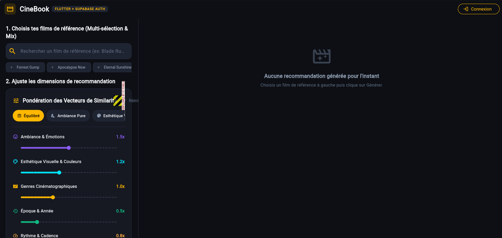
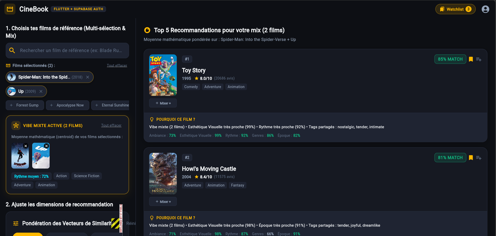
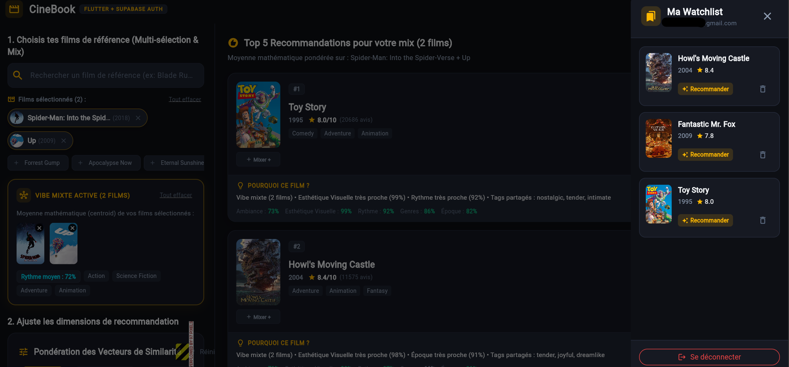

# 🎬 CineBook - AI Cinematic Vibe & Recommendation Engine

> Plateforme de recommandation de films intelligente basée sur l'atmosphère, l'esthétique visuelle, les palettes de couleurs et le rythme, plutôt que sur de simples notes numériques.

---

## 🏗️ Architecture du Projet (Monorepo)

```text
CineBook/
├── backend/        # API REST Python 3 & FastAPI + Base de données SQLite / SQLAlchemy
├── frontend/       # Application Flutter / Dart (Interface web & mobile en mode sombre)
├── data_pipeline/  # Scripts d'extraction de données (TMDb) et traitement d'image (OpenCV)
└── docs/
    └── images/     # Captures d'écran pour la documentation
```

---

## 🛠️ Stack Technique

| Couche              | Technologies & Outils                                                |
| ------------------- | -------------------------------------------------------------------- |
| **Frontend**        | Flutter / Dart (Responsive Web & Mobile, Material Design dark theme) |
| **Backend**         | Python 3.12, FastAPI, SQLAlchemy, Pydantic                           |
| **Base de Données** | SQLite                                                               |
| **Moteur & Data**   | TMDb API, OpenCV, Algorithme de Similarité Cosinus                   |

---

## 📸 Aperçu de l'Application

### 1. Page d'Accueil (`Home`)



### 2. Recherche et Sélection de Films (`Movie Search`)



### 3. Gestion de la Liste de Souhaits (`WishList`)



---

## 🚀 Installation et Lancement

Guide « zéro friction » pour cloner et lancer CineBook sur une machine vierge
(Windows, macOS ou Linux). **Aucune clé API n'est obligatoire** : les 142 films,
leurs vecteurs de caractéristiques et le cache des plateformes de streaming sont
livrés dans le dépôt (`data_pipeline/data/`), et la base SQLite se crée et se
peuple automatiquement au premier démarrage du backend.

### 0. Prérequis

| Outil | Version conseillée | Rôle |
| ----- | ------------------ | ---- |
| [Git](https://git-scm.com/) | récente | Cloner le dépôt |
| [Python](https://www.python.org/downloads/) | **3.12** (3.11 et + compatibles) | Backend FastAPI |
| [Conda](https://docs.conda.io/en/latest/miniconda.html) (Miniconda ou Anaconda) | récente | Environnement Python isolé — recommandé : il fournit Python 3.12 même si votre système a une autre version |
| [Flutter](https://docs.flutter.dev/get-started/install) (canal stable) | ≥ 3.27 | Frontend web & mobile |
| [Google Chrome](https://www.google.com/chrome/) | récent | Cible d'exécution `flutter run -d chrome` |

> 💡 Pas de Conda ? L'alternative `venv` + `requirements.txt` est décrite à l'étape 3 (option B).
> Vérifiez vos versions avec `git --version`, `python --version` et `flutter --version`.

### 1. Cloner le dépôt

```bash
git clone https://github.com/Romeo-dev27/CineBook.git
cd CineBook
```

### 2. (Optionnel) Configurer le fichier `.env`

Le backend fonctionne sans aucune configuration. Pour personnaliser le
comportement, copiez le modèle fourni puis éditez-le :

```bash
# Windows (PowerShell)
copy .env.example .env
# macOS / Linux
cp .env.example .env
```

- `TMDB_API_KEY` : **optionnelle** — rafraîchissement live des plateformes de
  streaming (clé gratuite sur https://www.themoviedb.org/settings/api).
  Sans elle, le cache local fourni dans le dépôt est utilisé.
- `JWT_SECRET` : **optionnel** — généré automatiquement s'il est absent.
- `DATABASE_URL` : **optionnel** — base SQLite à la racine du dépôt par défaut.

### 3. Créer l'environnement Python

**Option A — Conda (recommandée)**

```bash
conda env create -f backend/environment.yaml
conda activate cinebook
```

**Option B — venv + pip (sans Conda)**

```bash
python -m venv .venv
# Activation Windows : .venv\Scripts\activate
# Activation macOS / Linux : source .venv/bin/activate
pip install -r backend/requirements.txt
```

### 4. Lancer le Backend (FastAPI)

```bash
cd backend
uvicorn main:app --reload --port 8000
```

- API : http://127.0.0.1:8000
- Documentation interactive (Swagger UI) : http://127.0.0.1:8000/docs
- Au premier lancement, `cinebook.db` est créée et peuplée automatiquement
  depuis les JSON du dépôt (aucune connexion Internet requise).

### 5. Lancer le Frontend (Flutter)

Dans un **second terminal** (laissez le backend tourner dans le premier) :

```bash
cd frontend
flutter pub get
flutter run -d chrome
```

L'application pointe par défaut vers `http://127.0.0.1:8000/api`.
Pour viser un autre backend (ex. la version en ligne) :
`flutter run -d chrome --dart-define=API_URL=https://votre-backend/api`

### 6. Vérifier l'installation (optionnel)

```bash
cd backend
python -m pytest tests -q
```

Les 29 tests du backend doivent passer. Côté frontend : `flutter analyze`
ne doit remonter aucun issue.

---

## ✨ Fonctionnalités Clés (V2)

- **Sélection multiple (Multi-seed Vibe Builder) :** Combine plusieurs films pour moyenner et mixer leurs ambiances esthétiques.
- **Extraction de palettes visuelles :** Analyse des couleurs dominantes pour identifier des œuvres aux harmonies similaires.
- **Documentation API interactive :** Accessible en local via Swagger UI (`/docs`).
